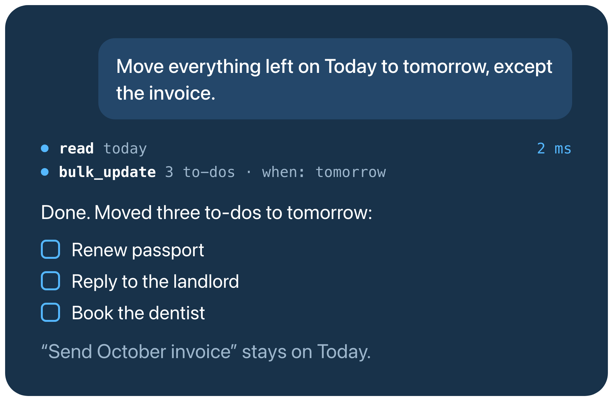

<p align="center">
  
</p>

<h1 align="center">nico-things-mcp</h1>

<p align="center"><b>Let your AI assistant run Things 3, without duplicate to-dos or stealing focus.</b></p>

<p align="center">
  <a href="https://github.com/proxynico/nico-things-mcp/releases/latest"></a>
  <a href="LICENSE"></a>
  <a href="#install"></a>
  <a href="https://modelcontextprotocol.io/"></a>
</p>

<p align="center">
  
</p>

A local [MCP](https://modelcontextprotocol.io/) server that lets Claude Code, Codex, Claude Desktop, or any other MCP app read and organise your Things 3 to-dos. It runs on your Mac and talks to Things directly, with no cloud service of its own. The to-dos it reads go to whichever AI model your assistant uses.

## Why this one

- **No duplicate to-dos.** AI apps resend a request when it times out. Each create carries an ID, so a resend gets back the to-do already made instead of adding a second one.
- **Things stays out of your way.** Things runs hidden and every change happens in the background, so its window never jumps in front of you.
- **Fast.** Reads come straight from Things' database on your Mac. A 942-item Logbook reads in 5 ms; the same read through AppleScript took 2 minutes 21 seconds.
- **It doesn't guess.** Creates and single updates reply with what Things saved, read back from Things. When something can't be seen, such as a checklist without database access, it says unknown instead of empty.

## Try asking

- "What's on Today, and what's overdue?"
- "Move everything left on Today to tomorrow, except the invoice."
- "Turn these meeting notes into a project with a to-do for each action."
- "What did I finish this week?"
- "Export my Work area as Markdown."

## Install

You need macOS, Things 3, and [Bun](https://bun.sh/) 1.3 or newer.

```sh
git clone https://github.com/proxynico/nico-things-mcp.git ~/nico-things-mcp
cd ~/nico-things-mcp && bun install --frozen-lockfile
claude mcp add --scope user things -- bun run ~/nico-things-mcp/src/index.ts
```

For Codex, use `codex mcp add things -- bun run ~/nico-things-mcp/src/index.ts`. For Claude Desktop, Cursor, and other apps, add this to their MCP settings with the full path:

```json
{
  "mcpServers": {
    "things": {
      "command": "bun",
      "args": ["run", "/Users/you/nico-things-mcp/src/index.ts"]
    }
  }
}
```

Then ask your assistant to run `doctor`. If macOS asks whether your terminal or AI app may control Things, allow it.

### Auth token

Reads and most changes need no setup. Scheduling for Evening, Anytime, or Someday, clearing a date, setting checklists, tags that contain commas, and `bulk_update` use Things' URL commands, which need its auth token. Find it in Things under Settings → General → Enable Things URLs → Manage, and give it to the server as `THINGS_AUTH_TOKEN` through your MCP app's settings. For Claude Code, add `-e THINGS_AUTH_TOKEN=<token>` just before the `--` in the command above. Keep it out of any repository.

## Tools

| Tool | What it does |
| --- | --- |
| `read` | A list (Inbox, Today, Anytime, Upcoming, Someday, Logbook, Trash), project, area, or item, or all projects, areas, or tags, with IDs |
| `search` | Open to-dos by name or tag |
| `export_markdown` | A list, project, area, or item as Markdown |
| `stats` | Completed, canceled, and created counts for any dates, plus overdue, Inbox, and Today counts |
| `add_todo`, `add_project` | Create with dates, tags, checklists, or child to-dos |
| `update`, `bulk_update` | Change one item or many |
| `delete`, `empty_trash` | Move to Trash, or empty it after explicit confirmation |
| `show` | Open a list or item in Things without bringing it to the front |
| `doctor` | Check which read and write paths work on this Mac |

## How it works

**Reads** come from Things' SQLite database, opened read-only. If it can't be read, they fall back to asking Things over JXA (JavaScript for Automation). `stats` needs the database. So do checklists, which Things' scripting interface can't read: without the database, items return `checklistItems: null` rather than an empty list.

**Writes** go through Things itself, using JXA and, for what JXA can't do, Things' URL commands. `update` replies with the item reread from Things, waiting up to two seconds for a changed checklist to reach the database. Creates reply with the new item's ID, name, and status, or the full reread item when they also set something only the URL commands can, such as a checklist. `bulk_update`, `delete`, and `empty_trash` reply with a short confirmation.

**Things stays running.** It only updates its database while it runs, so the server opens Things hidden when it starts. Right after that, reads can lag for the few seconds Things takes to sync.

**Duplicate protection.** `add_todo` and `add_project` require a `request_id`, such as a UUID:

- Use a new ID for each intended item, and reuse it with identical arguments after a timeout. The retry returns the original result. Reusing an ID with different arguments is refused.
- A started create finishes even if the caller cancels. Keep the connection open until the retry completes.
- A missing project or area fails before the ID is reserved, so the corrected call can reuse it.
- Outcomes are kept privately in `~/.local/state/nico-things-mcp/creates.sqlite`, shared by every server process on that Mac. Don't delete it to retry a failed create.
- If the server stops mid-create, that ID stays held. Read or update the item ID it reported, or search Things if none was saved. A retry can't restart it; it only returns an outcome if the original server saved one.
- IDs are per Mac; they don't deduplicate calls made on another Mac.

## Configuration

| Variable | Purpose | Default |
| --- | --- | --- |
| `THINGS_AUTH_TOKEN` | Things URL auth token, for the changes listed above | None |
| `THINGS_APP_PATH` | Things application path | `/Applications/Things3.app` |
| `THINGS_DB_PATH` | Explicit Things SQLite path | Auto-detected |
| `THINGS_FAST_READS` | Set to `0` to read through JXA instead of SQLite | Enabled |

## Development

```sh
bun run typecheck
bun test
bun run check
bun audit
```

See [CONTRIBUTING.md](CONTRIBUTING.md), [SECURITY.md](SECURITY.md), and the [MIT License](LICENSE).
